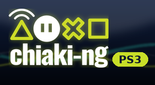
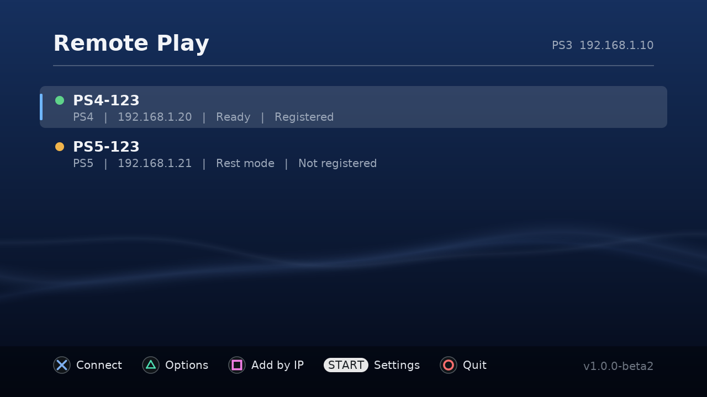
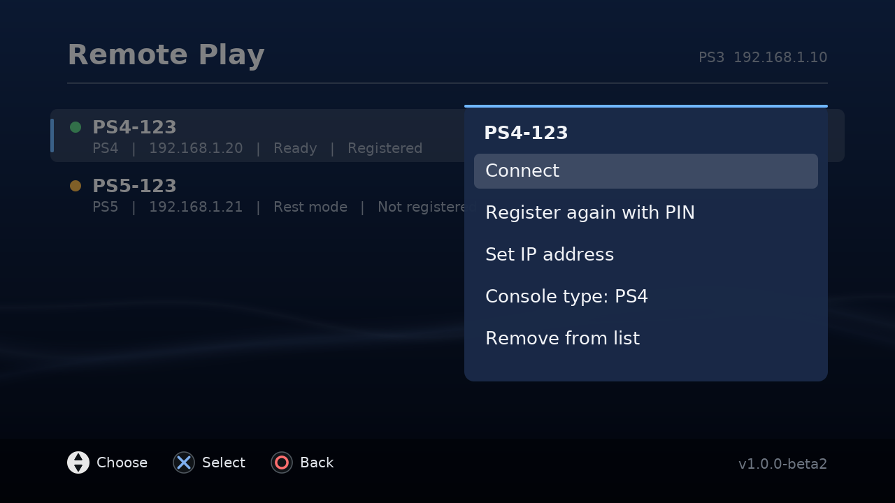
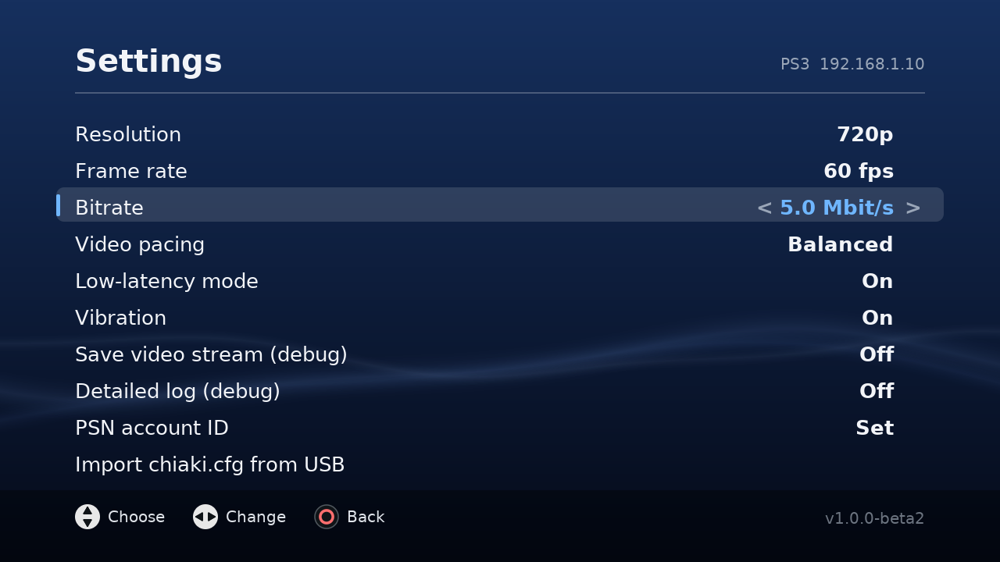
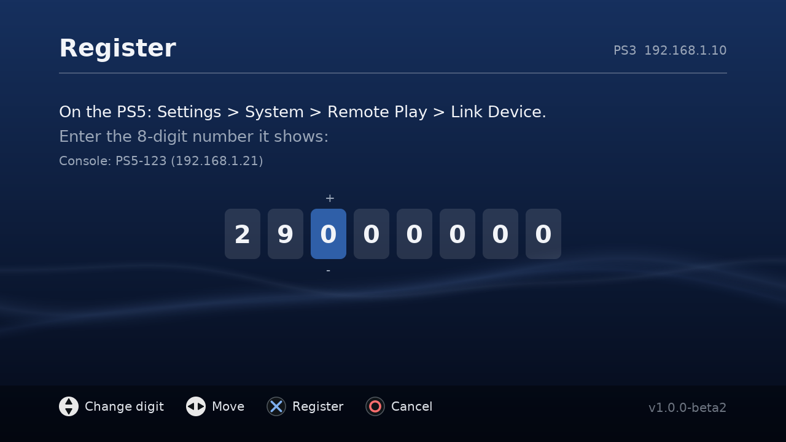

# Chiaki PS3 port: technical notes



PS4/PS5 Remote Play client for a PlayStation 3 running homebrew (CFW such as Rebug + Cobra),
built on the chiaki-ng core library with the open-source [ps3dev](https://github.com/ps3dev) toolchain (PSL1GHT).
For users: see the [main README](../README.md).

Target: PS4 and PS5 over wired LAN, 720p @ 60 fps, H.264 (the PS3 hardware decoder has no HEVC).

## Status

Tested on a real PS3 (Rebug + Cobra) with a standard PS4 and a PS5, wired: multi-minute sessions without
freezes, ~98.7% of frames reach the screen with "Balanced" pacing, audio stays in sync.

| Part | State |
|---|---|
| Core library for PS3 (PPU, big-endian), session | works |
| Start menu: console list with live discovery, add by IP, settings, back to the menu after a stream | works |
| Registration with PIN from the PS3 | works (PS5 tested) |
| Finding consoles on the network, waking them from rest mode | works (PS4 and PS5) |
| PS5 streaming (H.264 720p) | works |
| Video: hardware H.264 decoding with `libvdec` (4 SPUs) to ARGB, RSX scaled blit, 720p output | works; vdec holds each picture for one frame (~17 ms) |
| Frame pacing (lowest delay / balanced / smoothest) | works: ~98.7% of frames shown (balanced), ~96% (lowest delay) |
| Low-latency mode: no-reorder SPS rewrite (when needed), frame picked just before vsync | works; margin settles at ~3 ms |
| Audio: Opus to `libaudio`, adaptive jitter buffer with clock drift correction | works: 50-75 ms buffer, no growing delay |
| DualShock 3 input and vibration | works |
| Automatic retry when the console is not ready yet (e.g. right after another stream) | works |
| PSN account ID entry with the PS3 on-screen keyboard, `chiaki.cfg` import from USB | written, untested on hardware |
| Stats overlay (SELECT + TRIANGLE) | written, untested on hardware |
| Status/errors as XMB dialogs, `chiaki.log` with stats every 5 s, exit watchdog | works |
| Login PIN, internet play, microphone, motion, touchpad gestures | not supported |

## Using it

1. Install `chiaki-ps3.pkg` with Package Manager ("Chiaki PS3") and start it.
2. The start menu lists your consoles. PS4s on the same network show up by themselves.
   - ✕ on a registered console connects (a console in rest mode is woken up first).
   - ✕ on an unregistered console asks for the 8-digit PIN from
     PS4 Settings > Remote Play Connection Settings > Add Device, or
     PS5 Settings > System > Remote Play > Link Device. This needs your PSN account id in
     `chiaki.cfg` (see below).
   - △ console options (register again, set IP address, console type PS4/PS5, remove), □ add a console by IP address,
     START settings (resolution, frame rate, bitrate, debug options), ○ quit.
   - When the stream ends you are back in the menu.
3. Already registered in chiaki-ng on a PC? In chiaki-ng, export your settings to an `.ini`, then run
   `python3 tools/export_keys.py exported.ini > chiaki.cfg` and copy `chiaki.cfg` to the root of a USB
   stick or to `/dev_hdd0/game/CHIAKIPS3/USRDIR/` (FTP via webMAN MOD). It contains all your registered
   PS4s/PS5s and the PSN account id. Old single-console `chiaki.cfg` files still work.

To wake a console from rest mode: PS4 Settings > Power Save Settings > Set Features Available in Rest Mode >
"Stay Connected to the Internet" and "Enable Turning On PS4 from Network"; PS5 Settings > System > Power
Saving > Features Available in Rest Mode > "Stay Connected to the Internet" and "Enable Turning On PS5 from
Network". Use wired network if you can.

If something goes wrong, `/dev_hdd0/game/CHIAKIPS3/USRDIR/chiaki.log` says why.

| | |
|---|---|
|  |  |
|  |  |

### Reducing delay

- Put your TV in **Game Mode** (or "PC"/"Low latency" mode). TV picture processing often adds more delay
  than everything else combined.
- Use wired network for both consoles.
- Settings > Video pacing: "Lowest delay" if you notice the delay, "Smoothest" for slow games.
- Settings > Low-latency mode (on by default). Turn it off if the picture ever misbehaves, and please open an issue with `chiaki.log`.

### Controls (DualShock 3 → PS4)

| DS3 | PS4 |
|---|---|
| Face buttons, D-pad, L1/R1, L3/R3, sticks | same |
| L2/R2 | L2/R2 (analog, using the DS3 pressure sensors) |
| START | OPTIONS |
| SELECT (tap) | SHARE |
| SELECT + START | PS button |
| SELECT + CROSS | touchpad click (center) |
| SELECT + L1 / R1 | touchpad click left / right half |
| SELECT + TRIANGLE | show / hide the stats overlay |
| SELECT + CIRCLE (hold 1 s) | quit the stream |

The DS3's own PS button opens the PS3 menu, where "Quit Game" also works.

Vibration: the console's strong (low-frequency) rumble drives the DS3's large motor; strong light (high-frequency)
rumble also switches on its small motor, which can only be on or off. Text entry uses the console's own on-screen
keyboard in the stream.

### Bug reports

`chiaki.log`. The stats lines (`video in .. out .. shown .. decode avg/max ms | audio ..`) show
whether frames arrive, get decoded and reach the screen, and how long the hardware decoder takes.

## Building

```bash
export PS3DEV=/usr/local/ps3dev
export PSL1GHT=$PS3DEV
export PATH=$PATH:$PS3DEV/bin:$PS3DEV/ppu/bin
# toolchain: https://github.com/ps3dev/ps3toolchain (steps 1 2 4 5 6 8 are enough)
# mbedTLS:   https://github.com/ps3dev/ps3libraries (script 018-mbedTLS)
# host tools: protoc and python3-protobuf (for nanopb code generation)

git submodule update --init third-party/nanopb third-party/jerasure third-party/gf-complete ps3/third-party/opus
cd ps3
make        # chiaki-ps3.self
make pkg    # chiaki-ps3.pkg
```

## Port notes

- XMB artwork (`pkgfiles/ICON0.PNG`, `pkgfiles/PIC1.PNG`) is generated by `tools/gen_icons.py` from the chiaki-ng
  logo in `assets/official-artwork`.

- `__PS3__` is defined for all sources; `compat/ps3_compat.h` is force-included and adds the
  missing POSIX networking types (IPv6 structs, `sockaddr_storage`, `getaddrinfo` prototypes).
- `src/ps3_netcompat.c`: IPv4-only `getaddrinfo`/`getnameinfo` on top of PSL1GHT.
- `lib/src/thread_ps3.c`: chiaki threads, mutexes and condition variables on native lv2 primitives.
  lv2 condition variables are bound to one mutex, so they are created on first wait.
- `lib/src/stoppipe.c`: PS3 uses a loopback UDP socket and `poll()`. PSL1GHT socket descriptors carry
  bit 30 (`SOCKET_FD_MASK`), which makes `FD_SET` write out of bounds, so `select()` is avoided.
- Sockets are made non-blocking with `SO_NBIO` (there is no `fcntl` for sockets).
- newlib 1.20 (PSL1GHT) has no `%z` printf modifier and does not consume its argument, so later `%s`
  arguments read bogus pointers. `chiaki_log` rewrites `z`/`j`/`t` to `l` on PS3 (all are 64 bit on the PPU).
- `sizeof(struct sockaddr)` is 2 in PSL1GHT (flexible `sa_data[]`); never size an address buffer with it.
- An exit watchdog forces `sysProcessExit` if session teardown hangs for 5 s, so the PS3 can always return to the XMB.
- RSX command buffer: the firmware's automatic wrap-around stalled the GPU after ~89 s (twice, same point);
  `video.c` rewinds the ~28 KB buffer itself whenever it is half used and the GPU is idle.
- Entropy comes from the lv2 hardware RNG through the ps3libraries mbedTLS patch.
- `src/video.c`: libvdec opened at H.264 level 4.2 with up to 4 SPUs; pictures are converted to ARGB by vdec
  and written straight into one of three frame buffers in RSX local memory. Each vsync the newest frame is
  blitted (NV3089 scaled image, letterboxed) into the back buffer. The vdec callback needs a 32-bit function
  descriptor (`__get_opd32`), the same way PSL1GHT registers its GCM handlers. Pictures are dropped only when
  vdec marks them as skipped (`attr`), as in Movian.
- `src/audio.c`: thread woken by libaudio per consumed block, fed from `src/audioring.c`: a jitter buffer
  whose level is held at an adaptive target (60-150 ms) by playing up to +-0.5 % faster/slower with linear
  interpolation, because the PS4 and PS3 audio clocks differ slightly (~130 ppm in a test session).
  Tuned with `tools/audio_sim.c`.
- Low-latency mode: `src/h264_sps.c` rewrites the stream's SPS so its VUI declares
  `max_num_reorder_frames = 0` (and `max_dec_frame_buffering = max_num_ref_frames`): without it a decoder may
  hold a decoded picture back (the log measured exactly one frame, 17 ms, of decoder delay). Verified with
  ffmpeg on x264 streams with/without VUI, HRD, scaling matrices and cropping (`tools/sps_test.c`): rewritten
  streams decode to identical pictures. The log's `held` value shows how many newer frames had been submitted
  when a picture came out (0 = no holding). `video.c` also picks the frame shortly before the vsync (adaptive
  3-10 ms margin, missed vsyncs logged as `late`) instead of right after the previous one.
- Frame pacing: `src/framequeue.c` keeps decoded frames in a short FIFO (5 RSX buffers) and shows one per
  vsync, skipping one only after a sustained backlog. Tuned with `tools/pacing_sim.c`
  (newest-frame-only showed ~90% of frames in simulation, the old behaviour).
- `src/input.c`: DS3 mapping, SELECT acts as a modifier for the buttons a DS3 lacks; menu events with D-pad repeat.
- Menu: `src/menu.c` (state, input, drawing) and `src/ui.c` (software 2D: text from an embedded DejaVu Sans
  atlas generated by `tools/gen_font.py`, button glyphs, gradients) are platform independent, so
  `tools/menu_preview.sh` renders every screen to PNG on a PC. `src/menu_shell.c` is the PS3 side
  (live discovery, registration, saving). The menu image is drawn in main memory and copied into one of
  two RSX buffers, then shown with the same scaled blit as video.
- `src/remote_stubs.c`: stubs for PSN hole punching and AIA certificate recovery (need libcurl).
- Big-endian check: the chiaki unit tests pass on big-endian ppc64 Linux under qemu
  (105/106; the one failure, `gkcrypt/ecdh`, fails the same way on x86 with the mbedTLS backend:
  `chiaki_ecdh_set_local_key` regenerates the key, and only the test calls it).
